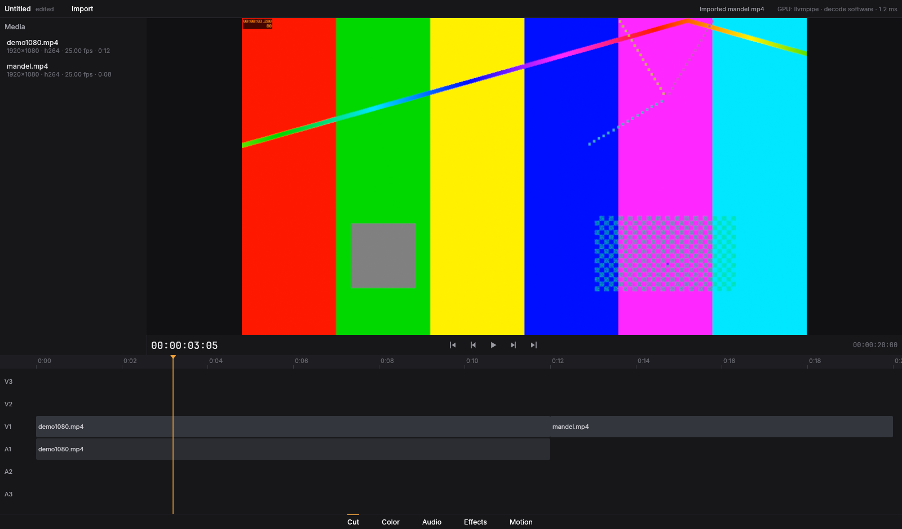

# Fase 0 — Esqueleto

**Objetivo:** workspace, janela, tema, importar um vídeo e reproduzir com áudio
sincronizado.



*Captura real do app (Xvfb + Vulkan llvmpipe): duas mídias 1080p importadas, o
viewer mostra o quadro em 00:00:03:05 renderizado pela GPU (o timecode
gravado no próprio vídeo, "03.200", confere).*

## O que foi implementado

**Workspace e documentação**
- Workspace Cargo com as 8 crates pedidas + `kompo-engine` (justificativa em
  `docs/DECISIONS.md`, D1). O core não depende de nada da interface.
- `docs/DESIGN.md` (design system: cores, espaçamento, tipografia, movimento,
  componentes, layout das páginas) — entregue antes das telas e espelhado em
  `crates/kompo-app/src/theme.rs`.
- `docs/DECISIONS.md` com 12 decisões, incluindo a escolha de egui (comparada
  com iced e Slint) e o registro do FFmpeg via `ffmpeg-next`/`ffmpeg-sys-next`
  com a implicação LGPL × GPL.
- `docs/PERFORMANCE.md` com as metas e como são medidas.

**kompo-core**
- Tempo em ticks de 1/705 600 000 s (exato para todas as taxas de quadro e de
  amostragem), timecode drop-frame/non-drop, intervalos.
- Modelo completo de mídia, sequência, trilhas, clipes, transformações,
  marcadores, multicam, efeitos/transições (dados), mixer de áudio (dados) e
  correção de cor (dados).
- Parâmetros animáveis com keyframes Hold/Linear/Bézier.
- Histórico de undo/redo ilimitado por snapshots persistentes (`imbl`).
- Arquivo de projeto `.kompo` versionado com migrações e gravação atômica.

**kompo-media**
- Probe (contêiner, streams, cor, rotação, timecode).
- Decoder de vídeo com seek preciso ao quadro, decodificação por hardware
  (NVDEC, VAAPI, D3D11VA, DXVA2, VideoToolbox) e fallback multi-thread;
  suporte direto a 4:2:0/4:2:2/4:4:4 8/10/12 bits, NV12, P010, RGBA; demais
  formatos via swscale.
- Decoder de áudio FFmpeg (fallback do symphonia).
- PNG/JPEG (`image`) e OpenEXR (`exr`), leitura e escrita.
- Encoder/muxer (`MediaWriter`) — base da exportação da Fase 2.
- Gerador de mídia de teste com o número do quadro gravado na imagem e bipes
  sincronizados no áudio.

**kompo-audio**
- Conform em disco (symphonia → rubato → f32 na taxa do projeto) com arquivo
  de picos para formas de onda; leituras posicionais (memória constante).
- Mixer de timeline (ganho/pan de clipe e de trilha com automação, fades,
  velocidade/reverso, solo/mute).
- Saída cpal em tempo real com ring buffer sem lock, flush por época no seek,
  compensação de latência, dispositivo nulo quando não há placa de som.
- Relógio mestre: a posição audível dirige o vídeo.

**kompo-color**
- 12 curvas de transferência (sRGB, BT.1886, gamma 2.2/2.6, PQ, HLG, ACEScct,
  ACEScc, LogC3, S-Log3, V-Log, linear) em Rust e WGSL.
- Primárias (Rec.709, Rec.601, Rec.2020, DCI-P3, Display P3, ACES AP0/AP1) com
  adaptação Bradford; matrizes Y'CbCr e faixas limitada/completa.

**kompo-gpu**
- Grafo de render independente de backend (fonte, imagem, sólido,
  composição com transformação/opacidade/crop/12 modos de mistura).
- Backend wgpu/WGSL: conversão Y'CbCr→linear com redução para a resolução de
  exibição, composição premultiplicada, transformação de saída com dither;
  pool de texturas e cache de quadros.
- Backend CPU (rayon) com as mesmas fórmulas.

**kompo-engine**
- Workers de decodificação por clipe (pedido mais recente vence, decodifica
  adiante na reprodução, pré-aquece o próximo clipe).
- Montagem do grafo a partir da sequência (fit, transformações, opacidade,
  blend, crop, geradores sólido/barras, multicam).
- Ponte de áudio (conform em segundo plano, programa de mixagem).
- Player: play/pause, J/K/L, passo de quadro, seek, loop, fim de timeline.
- `kompo-bench` com os cenários de desempenho.

**kompo-app**
- Janela eframe/wgpu com o tema do design system e fontes embarcadas.
- Página Cut: media pool (some quando vazio), viewer com renderização direta
  na GPU, transporte com glifos vetoriais, timeline de visão geral com régua e
  scrubbing; barra de páginas Cut/Color/Audio/Effects/Motion (troca
  instantânea); importação por Ctrl+I, arrastar-e-soltar ou linha de comando.

## O que ficou de fora (e quando entra)

- Edição na timeline (ferramentas, magnetismo, ripple/roll/slip/slide,
  lâmina), salvar/abrir pela interface, EDL/FCPXML → **Fase 1**.
- As páginas Color, Audio, Effects e Motion mostram por enquanto o mesmo
  viewer e a timeline; seus painéis entram nas Fases 3–6.
- Interop zero-cópia entre o decoder de hardware e o wgpu (hoje o quadro
  decodificado em hardware é copiado para a memória do sistema e reenviado) →
  avaliado na **Fase 8**.
- Meta M1 (4K, 3 camadas, 2 efeitos em tempo real) **não pôde ser
  confirmada** neste ambiente sem GPU; o gargalo está documentado em
  `docs/PERFORMANCE.md`. Os efeitos em si entram na Fase 3.

## Como rodar

```sh
sudo apt install pkg-config clang libclang-dev libavcodec-dev libavformat-dev \
  libavutil-dev libswscale-dev libswresample-dev libavfilter-dev libavdevice-dev \
  libasound2-dev libxkbcommon-dev libxkbcommon-x11-0     # Linux
cargo run --release -- caminho/do/video.mp4                # abre e importa
```

No app: **Espaço** toca/pausa, **J/K/L** shuttle, **←/→** quadro a quadro,
**Ctrl+I** importa, arrastar arquivos para a janela também importa; clicar ou
arrastar na timeline move o playhead.

## Testes

`cargo test --workspace` — **47 testes, todos passando**:

| Crate | Testes | Destaques |
|---|---|---|
| kompo-core | 14 | taxas NTSC exatas, timecode drop-frame (ida e volta), keyframes Bézier |
| kompo-color | 9 | ida e volta das 12 transferências, matriz BT.2087 (709→2020), luma Rec.709 |
| kompo-media | 6 | **seek aleatório preciso ao quadro** (40 saltos, inclusive para trás), 10 bits, decode sequencial, áudio, PNG/EXR |
| kompo-audio | 5 | reamostragem 44,1→48 kHz com alinhamento de fase, conform, **relógio em tempo real e seek** |
| kompo-gpu | 10 | **paridade GPU × CPU** em 8/10 bits, NV12, RGBA, float, downscale, 12 modos de mistura com rotação/crop; pool de texturas limitado |
| kompo-engine | 3 | quadro exato através da timeline; áudio no lugar certo; **reprodução contra o relógio de áudio: 137 amostras, 100% em sincronia** |

## Benchmarks

`kompo-bench --quick` neste container (4 vCPUs, sem GPU — llvmpipe):

| Cenário | Resultado | Meta |
|---|---|---|
| decode_4k_h264 | 49,9 fps | ≥ 30 |
| decode_4k_hevc | 33,1 fps | ≥ 30 |
| playback 4K, 3 camadas | p95 817 ms/quadro (não atingida — gargalo: rasterização em software + 3 decodes 4K em 4 núcleos) | 30 fps |
| scrub_4k_h264 | 5,5 ms máx. na UI (nunca bloqueia) | < 16,7 ms |
| memory_soak | +0,68% RSS | < 5% |
