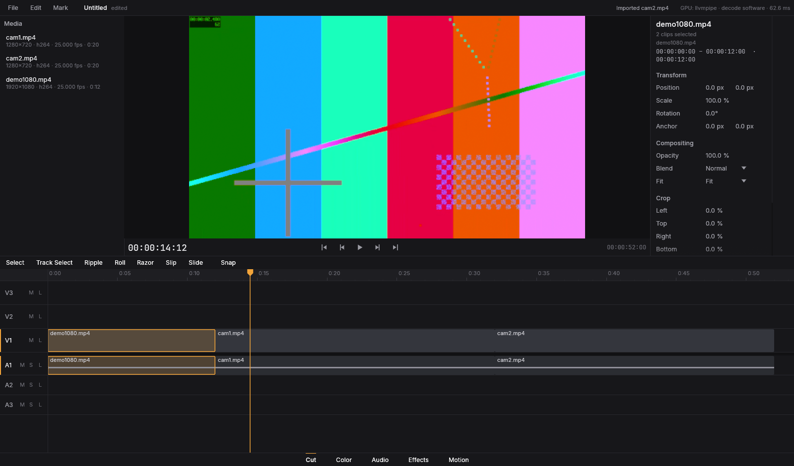
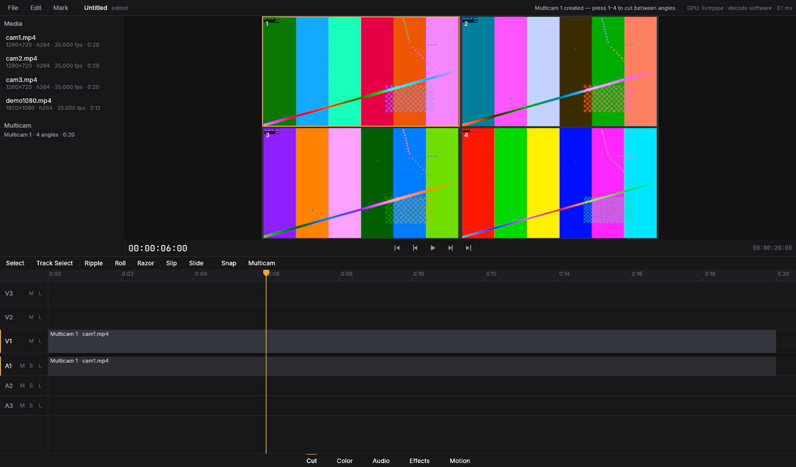

# Fase 1 — Timeline e corte

**Objetivo:** modelo de dados, undo/redo ilimitado, ferramentas básicas de
edição, salvar e abrir projeto.





*Capturas reais (Xvfb + llvmpipe). Em cima: media pool, viewer, inspector
(aparece só com seleção — aqui o par vídeo+áudio vinculado, contornado em
âmbar), paleta de ferramentas e timeline com forma de onda. Embaixo: multicam
de 4 ângulos sincronizados, ângulo ativo em âmbar; as teclas 1–4 cortam entre
ângulos.*

## O que foi implementado

**Motor de edição (`kompo-core/src/edit.rs`)** — funções puras, cada uma um
passo de undo:

| Operação | Comportamento |
|---|---|
| Inserir / sobrescrever | coloca clipes nas trilhas de destino; inserir empurra o material posterior nas trilhas de destino e nas trilhas com sync lock |
| Lift / Delete | remove deixando lacuna |
| Ripple Delete | remove e fecha a lacuna em todas as trilhas onde isso não apaga material |
| Lift / Extract de In–Out | `;` e `'` sobre todas as trilhas destravadas |
| Lâmina / Add Edit | corta no tempo dado (trilha, vinculados ou todas); keyframes e marcadores ficam no lugar; metades da direita ganham novo vínculo |
| Mover | sobrescrever ou inserir, entre trilhas, cria trilha nova acima do topo |
| Trim | normal (bloqueado por vizinhos e pela mídia) e ripple (material posterior acompanha) |
| Roll | move o ponto de edição entre dois clipes |
| Slip | muda o trecho da fonte sem mover o clipe |
| Slide | move o clipe entre os vizinhos aparando-os |
| Velocidade/reverso | duração acompanha, limitada pela mídia |
| Vincular/desvincular, marcadores (sequência e clipe), trilhas (adicionar/remover, travar, mudo, solo) | |
| Magnetismo | pontos de snap: bordas de clipes, playhead, marcadores, In/Out |
| Multicam | criação por pontos de entrada, timecode ou **sincronização por áudio**; troca de ângulo no playhead |

Todas respeitam os limites da mídia, clipes vinculados e trilhas travadas
(detalhes e regra de sync lock em `docs/DECISIONS.md`, D13).

**Undo/redo ilimitado** por snapshots persistentes, com gestos agrupados (um
arrasto = um passo, reaplicado a partir da base a cada quadro) e cancelamento
com Esc.

**Projeto**: salvar (atômico, com `.bak`), salvar como, abrir (detecção de
mídia offline e *relink*), novo, autosave a cada 3 min (pasta de dados do
usuário), confirmação ao fechar com alterações.

**Intercâmbio**: EDL CMX3600 e FCPXML 1.10 — exportação e importação, com
localização automática das mídias (D14).

**Interface (página Cut)**:
- Timeline completa: régua com timecode adaptativo, trilhas de vídeo em cima e
  áudio embaixo, cabeçalhos com destino (clique no nome), M/S/L, altura
  ajustável arrastando a borda; clipes com nome, velocidade, "fx", marcadores,
  estado offline; formas de onda dos picos do conform; In/Out; marcadores da
  sequência (arrastar para mover, menu para apagar); playhead; linha de snap;
  fantasmas durante o arrasto; seleção por clique, Shift/Ctrl, retângulo;
  zoom com Ctrl+roda ou pinça, rolagem horizontal/vertical, acompanhamento do
  playhead na reprodução; menus de contexto.
- Ferramentas: Seleção (V), Seleção de trilha para frente (A), Ripple (B),
  Roll (N), Lâmina (C), Slip (Y), Slide (U); magnetismo (S).
- Media pool: ordenado por nome, seleção múltipla, arrastar para a timeline
  (sobrescrever; com Ctrl, inserir), duplo clique anexa, menu com
  inserir/sobrescrever no playhead, criar multicam (áudio/timecode/entradas),
  relink, remover; indica análise de áudio em andamento.
- Inspector (só com seleção): timecodes de entrada/saída/duração, posição,
  escala (uniforme ou por eixo), rotação, âncora, opacidade, modo de mistura,
  enquadramento (Fit/Fill/Stretch/1:1), crop, velocidade/reverso, ganho e pan
  do áudio vinculado. Cada arrasto de campo é um passo de undo.
- Viewer com grade multicam (clique num ângulo corta para ele).
- Menus File / Edit / Mark com os atalhos visíveis.

**Atalhos (estilo Premiere)**: Espaço, J/K/L, ←/→ (Shift: 5 quadros), ↑/↓
(edição anterior/seguinte), Home/End, I/O/X, Ctrl+Shift+X, M, Ctrl+K,
Ctrl+Shift+K, Delete, Shift+Delete / Alt+Backspace, `;`, `'`, `,` e `.`
(inserir/sobrescrever do media pool), Ctrl+A, Ctrl+Shift+A, Ctrl+C/V,
Ctrl+L, 1–9 (ângulo multicam), Shift+0 (visão multicam), `=`/`-`/`\` (zoom),
Ctrl+Z/Ctrl+Shift+Z, Ctrl+S/Ctrl+Shift+S/Ctrl+O/Ctrl+N/Ctrl+I, Shift+1…5
(páginas).

**Engine**: fila limitada (2 workers) para o conform de áudio; conform já em
cache abre na hora; grade multicam no player; módulo `project_io`.

## O que ficou de fora

- Miniaturas (filmstrip) nos clipes de vídeo → cache de miniaturas na Fase 8.
- Várias trilhas de destino simultâneas (o modelo atual é um V e um A).
- Monitor de origem separado (fonte + programa): edição de três pontos usa o
  media pool + In/Out da sequência.
- Renomear marcadores pela interface (há criar, mover, apagar).
- Páginas Color/Audio/Effects/Motion ainda sem painéis próprios (Fases 3–6).

## Como rodar

```sh
cargo run --release -- clipe1.mp4 clipe2.mp4          # importa e abre
cargo run --release -- projeto.kompo                  # abre projeto
cargo run --release -- edicao.fcpxml                  # importa FCPXML/EDL
cargo run --release -- a.mp4 b.mp4 c.mp4 --multicam   # demo: multicam
```

## Testes

`cargo test --workspace` — **84 testes, todos passando** (37 novos nesta fase):

| Suite | Testes | O que cobre |
|---|---|---|
| core `tests/edit.rs` | 20 | cada operação acima, travas, snapping, multicam, velocidade e **fuzz de 3 000 edições aleatórias** checando invariantes a cada passo e undo/redo exato de todos os estados |
| core `tests/interchange.rs` | 5 | ida e volta EDL e FCPXML, dissolve no estilo Premiere, documento no estilo Final Cut (clip/video aninhados, lanes, 29,97, DF) |
| core `history` | 3 | gesto = um passo, reaplicação a partir da base, cancelamento |
| engine `tests/project.rs` | 3 | salvar/abrir com mídia real, detecção de offline, `.bak`; importação EDL/FCPXML achando mídia pelo caminho; **multicam sincronizado por áudio** (erro < 5 ms; os dois ângulos mostram o mesmo quadro) |
| audio `sync` | 1 | atraso conhecido de 1,276 s encontrado com 1 ms de precisão |
| app `tests/shortcuts.rs` | 5 | a UI real dirigida por eventos de teclado: Ctrl+K/undo/redo, teclas de ferramenta, I/O/`'`, M, Ctrl+A, Shift+Delete, troca de página |

## Benchmarks

| Cenário | Resultado | Meta |
|---|---|---|
| project_open_500 | **848 ms** (parse + checagem 25 ms) | < 2 s |
| ui_timeline_heavy (5 000 clipes) | **2,38 ms** p95 de CPU por quadro | < 8 ms |
| fase 0 (decode, scrub, memória) | sem regressão | — |

O workflow **Benchmarks** agora roda também `kompo-ui-bench --strict`.
