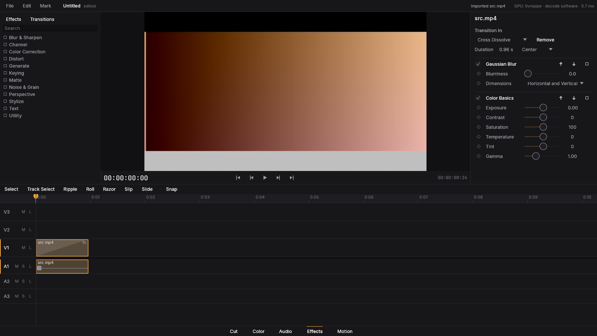

# Fase 3 — Efeitos, transições e keyframes

## O que foi implementado
- **Grafo de render** com novos nós: `Cpu` (operador em CPU com readback), `Lut` (LUT 3D, 65³ em *shaper* logarítmico) e `Blur`; backends GPU e CPU com testes de paridade.
- **`kompo-fx`**: catálogo de **306 efeitos** da biblioteca vendorizada (`third_party/effectcraft`, MIT OR Apache-2.0) mais efeitos nativos na GPU (`kompo.blur`, cor básica). Categorias, busca e parâmetros tipados na UI.
- **Transições**: nativas (dissolve, dip, wipes, push/slide) e as da biblioteca, dirigidas pela fração de conclusão; aplicadas nas janelas `transition_in/out` do clipe.
- **Keyframes** com Bézier (alças), Easy Ease, interpolação linear/hold e editor de gráfico (`params_ui::graph_window`); todo parâmetro de efeito, opacidade e mixer é animável.
- Página **Effects**: biblioteca, pilha de efeitos do clipe, inspector, gráfico de keyframes.

## O que ficou de fora
- Efeitos da biblioteca rodam na CPU (leitura/escrita da GPU); só blur e cor são 100% GPU.
- Transições de áudio (crossfade) estão na Fase 5; transições personalizadas via OFX não existem (contexto Transition do OFX não suportado).

## Como rodar
`cargo run --release -- --add-fx --add-transition clip.mp4` abre já com um efeito e uma transição; página **Effects**.

## Testes
`kompo-engine/tests/effects.rs` (7), `kompo-fx` (unitários), paridade GPU×CPU em `kompo-gpu/tests/parity.rs`. Todos passam.

## Benchmarks
Ver `docs/PERFORMANCE.md` (Fases 3–8): efeitos em 4K não atingem tempo real sem GPU.
