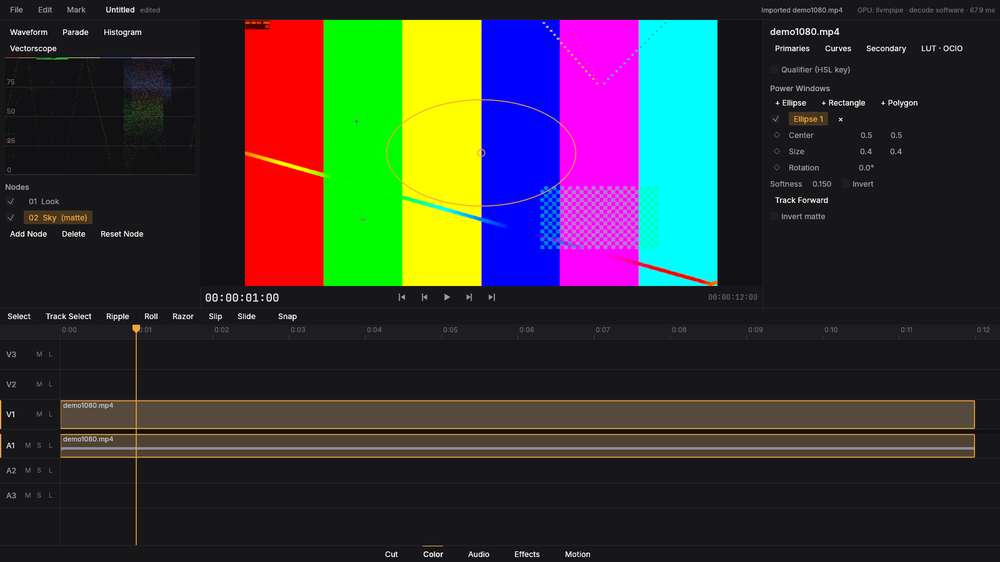

# Fase 4 — Cor

## O que foi implementado
- Pipeline linear em ponto flutuante com espaço de trabalho configurável; cada nó de correção vira uma **LUT 3D** (tempo real na GPU).
- Página **Color**: nós em série, primárias (lift/gamma/gain/offset), rodas, curvas, saturação/matiz, balanço e *printer lights*.
- **Qualificador** HSL e janelas (círculo, retângulo, polígono) como matte; **tracker** por *template matching* para janelas animadas.
- **LUTs** `.cube` (1D/3D) importáveis e **OCIO**: o leitor de configuração é nosso; a transformação é "assada" em LUT.
- **Scopes** (waveform, parade, vectorscope, histograma) com `filmcraft-scopes`.

## O que ficou de fora
- Qualificador/janelas rodam na CPU (matte) — fora do caminho de tempo real em 4K.
- OCIO: subconjunto de transformações (matriz, exposure/contrast, FileTransform, ColorSpace, Log); sem GPU shader generation do OCIO.
- HDR no viewer (exibição Rec.709 apenas; exportação HDR10/HLG existe).

## Como rodar
`cargo run --release -- --demo-grade clip.mp4`; página **Color**.

## Testes
`kompo-color` (LUT, curvas, qualificador, OCIO) e `kompo-fx::grade`; paridade da LUT GPU×CPU. Todos passam.

## Benchmarks
LUT 65³ + blur em 4K: ver PERFORMANCE.md.
