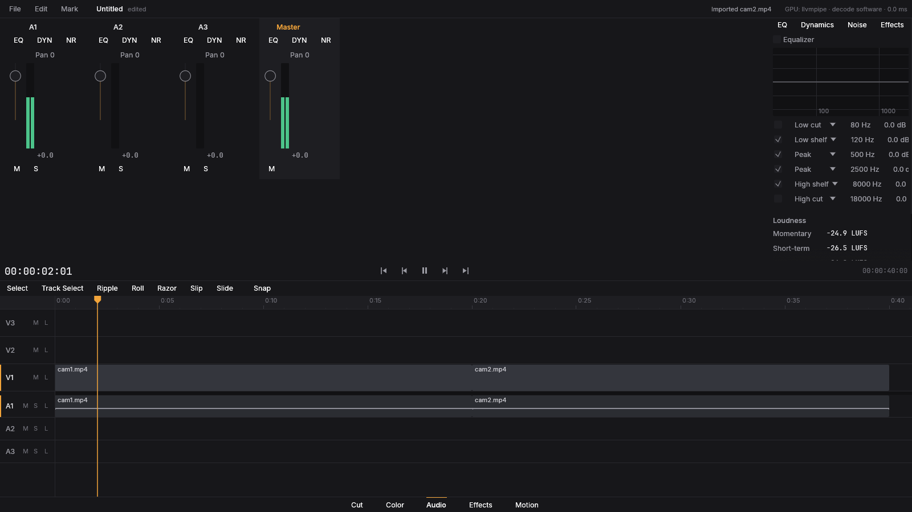

# Fase 5 — Áudio

## O que foi implementado
- Mixer por faixa com ganho, pan, mute/solo e **slots de efeito** (denoise, EQ paramétrico, compressor e `audio.*` de `filmcraft-audio-dsp`), com suavização de parâmetros e **compensação de latência**.
- Medidores **EBU R128** (momentâneo, curto prazo, integrado, LRA, true peak) em tempo real e medição offline.
- Keyframes de volume/pan; crossfades; página **Audio** com mixer, medidores e janela de efeitos.

## O que ficou de fora
- Gravação de locução (voice-over), plugins de áudio externos (VST/AU), surround >2 canais no mixer (entrada multicanal é mixada em estéreo).

## Como rodar
Página **Audio**. Sem placa de som: `KOMPO_NULL_AUDIO=1`.

## Testes
`kompo-audio/tests/mixer.rs` (4), `clock.rs` (1), unitários de DSP/medidor. Todos passam.

## Benchmarks
Mixer em tempo real com folga ampla no container (o gargalo do projeto é vídeo).
