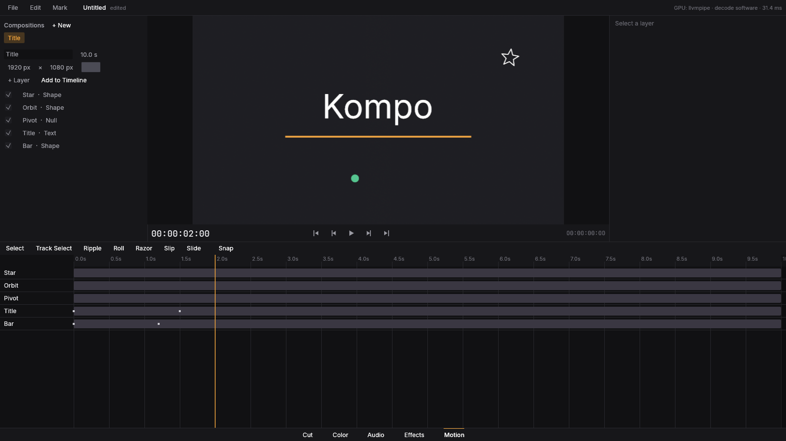

# Fase 6 — Motion

## O que foi implementado
- Composições em camadas (sólido, imagem, vídeo, forma, texto, câmera 2D, nulos), **pai/filho**, modos de mistura, máscaras e **pré-composições** recursivas (`ClipSource::Composition`).
- **Expressões** (linguagem própria: `time`, `wiggle`, `loopOut`, `linear`, `ease`, `thisComp.layer(..)`).
- Formas vetoriais e texto rasterizados com `effectcraft-path`/`effectcraft-text`; efeitos por camada.
- Página **Motion**: lista de camadas, inspector, timeline de keyframes, viewer da composição.

## O que ficou de fora
- Câmera/luzes 3D e camadas 3D, rastreamento de movimento em camadas, partículas.
- Texto: animadores por caractere.

## Como rodar
`cargo run --release -- --demo-motion`; página **Motion**.

## Testes
`kompo-motion/tests/render.rs` (7) + unitários do parser/avaliador. Todos passam.

## Benchmarks
Composições simples renderizam em CPU a taxas interativas em 1080p; sem benchmark dedicado.
